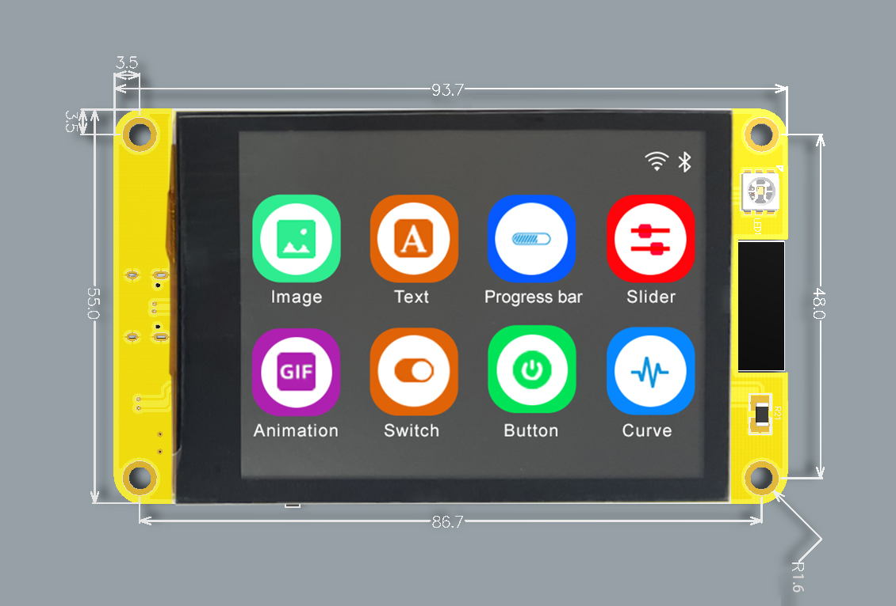

# ESP32-2432S032 · 3.2" "Cheap Yellow Display"

**English** · [Русский](README.ru.md)



**TL;DR** The vendor package for the 3.2-inch ESP32 display board (ESP32-2432S032, a "CYD"), kept in one place: Arduino demos with the exact libraries they were built against, datasheets, schematics, the flashing tool and ready-to-flash firmware images.

## The board

| | |
|---|---|
| MCU | ESP32-WROOM-32, dual core 240 MHz, Wi-Fi + Bluetooth, 520 KB SRAM |
| Flash | 4 MB |
| Display | 3.2" IPS TFT, 240×320, ST7789, 65K colors |
| Touch | **N**: none · **R**: resistive (XPT2046) · **C**: capacitive (GT911) |
| On board | microSD slot, speaker amplifier (FM8002A), RGB LED, light sensor, DHT11 connector, Li-ion charging |
| Power | 5 V over USB (CH340), about 140 mA |
| Size | 93.7 × 55.0 mm, about 40 g |

## Pinout

| Function | GPIO |
|---|---|
| Display SPI (HSPI) | SCLK 14 · MOSI 13 · MISO 12 · CS 15 · DC 2 · RST 35 |
| Backlight | 27 (PWM) |
| Resistive touch, XPT2046 (R) | SCK 14 · MOSI 13 · MISO 12 · CS 33 · IRQ 36 |
| Capacitive touch, GT911 (C) | SDA 33 · SCL 32 · RST 25 |
| microSD (VSPI) | SCK 18 · MOSI 23 · MISO 19 · CS 5 |
| Speaker | 26, internal DAC (left channel) |

Full schematics: [MCU](5-Schematic/ESP32-2432S032-MCU-V1.0%20.jpg), [LCD](5-Schematic/ESP32-2432S032-LCM-V1.0%20.jpg), [ESP32 module pins](5-Schematic/ESP32-WROOM-1%20Pin%20definition.png).

## Quick start

### Flash a ready demo

The images in `8-Burn operation/Burn files` are merged images that start at `0x0`.

```bash
pip install esptool
```

```bash
python3 -m esptool --chip esp32 --port /dev/cu.usbserial-110 write_flash 0x0 "8-Burn operation/Burn files/3.2R-LvglWidgets-R.bin"
```

Use `3.2R-…` for the resistive board, `3.2C-…` for the capacitive one and `LvglMusic3.2_gt911.bin` for the music player on the capacitive board. To find the port, run `ls /dev/cu.*` on macOS or `ls /dev/ttyUSB*` on Linux, or look in Device Manager on Windows.

### Build the demos in Arduino IDE

1. Install the **esp32** core **2.0.x** in Boards Manager (2.0.17 works). The demos call `ledcSetup` and `ledcAttachPin`, which core 3.x removed.
2. Copy the folders from `1-Demo/Demo_Arduino/Libraries` into your Arduino `libraries` folder. `TFT_eSPI_original/User_Setup.h` is already set up for this board.
3. Open a sketch from `1-Demo/Demo_Arduino`, pick **ESP32 Dev Module** and upload.

## What's inside

| Folder | Contents |
|---|---|
| [1-Demo](1-Demo/Demo_Arduino) | Arduino sketches and bundled libraries: TFT_eSPI 2.4.72, LVGL 8.3.3, Arduino_GFX 1.2.9, ESP32-audioI2S 2.0.0, TAMC_GT911 1.0.2 |
| [2-Specification](2-Specification) | Board specification (PDF) |
| [3-Structure_Diagram](3-Structure_Diagram) | Dimensions drawing |
| [4-Driver_IC_Data_Sheet](4-Driver_IC_Data_Sheet) | ESP32-WROOM-32, 25Q32 flash, FM8002A amplifier, DHT11 |
| [5-Schematic](5-Schematic) | Schematics and module pinout |
| [6-User_Manual](6-User_Manual) | Getting started guide (PDF), a Markdown copy is in [docs](docs/Getting%20started%203.2/Getting%20started%203.2.md) |
| [7-Character&Picture_Molding_Tool](7-Character%26Picture_Molding_Tool) | Vendor tools for Windows: CH340 driver, serial terminals, image compressor, hex editor |
| [8-Burn operation](8-Burn%20operation) | Ready firmware images, Espressif Flash Download Tool 3.9.3 for Windows, screenshots of the flashing steps |

<details>
<summary>Demo list</summary>

| Sketch | What it shows |
|---|---|
| 3_1 Helloworld, 3_2 Uart | Serial output |
| 3_3-1 … 3_3-3 | TFT text, clock, PDQ graphics test, LVGL benchmark |
| 3_3-4, 3_3-5 | LVGL widgets with resistive and capacitive touch |
| 4_1 … 4_6 | Wi-Fi AP, station, SmartConfig, TCP server and client, UDP |
| 4_7 … 4_9 | Web servers: LED, relay, DHT11 readings |
| 5_1 BleService | Bluetooth LE service |
| 7_1, 7_2 | LVGL music player from the SD card, resistive and capacitive |
| 8_1 | LVGL with DMA on the capacitive board |

The Wi-Fi sketches hold the vendor's sample network name and password: put your own in before uploading.

</details>

## Credits

The documents, demos and tools come from the board vendor and are mirrored unchanged. The bundled libraries belong to their authors: [TFT_eSPI](https://github.com/Bodmer/TFT_eSPI), [LVGL](https://github.com/lvgl/lvgl), [Arduino_GFX](https://github.com/moononournation/Arduino_GFX), [ESP32-audioI2S](https://github.com/schreibfaul1/ESP32-audioI2S), [TAMC_GT911](https://github.com/TAMCTec/gt911-arduino).
