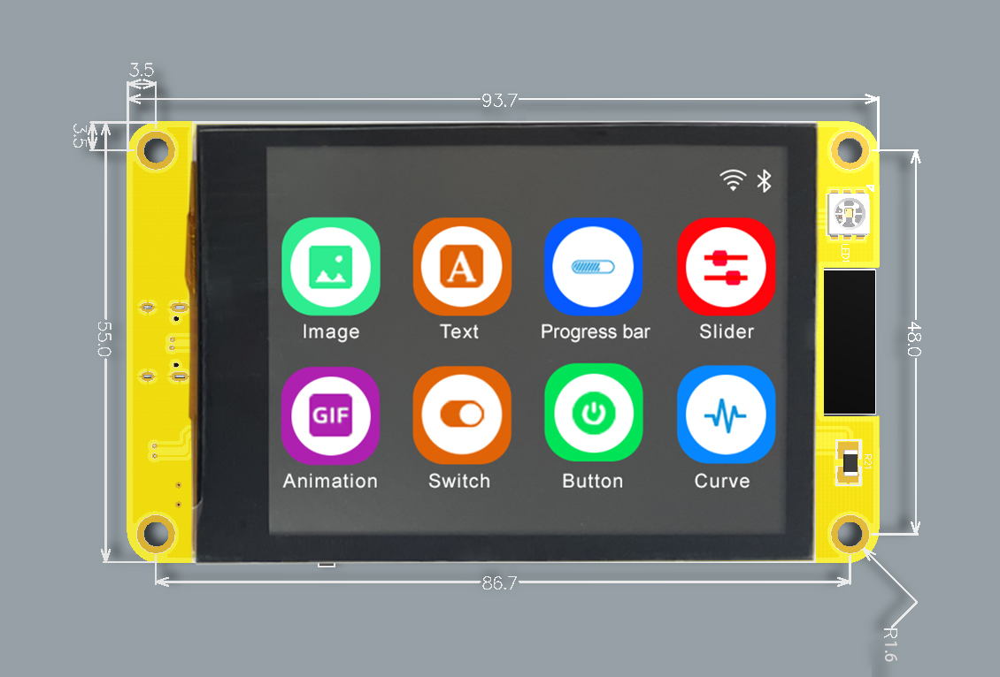

# ESP32-2432S032 · 3,2" «Cheap Yellow Display»

[English](README.md) · **Русский**



**TL;DR** Комплект от производителя для 3,2-дюймовой платы с ESP32 и экраном (ESP32-2432S032, из семейства «CYD») в одном месте: демки для Arduino вместе с теми самыми версиями библиотек, даташиты, схемы, прошивальщик и готовые образы прошивок.

## Плата

| | |
|---|---|
| Микроконтроллер | ESP32-WROOM-32, два ядра 240 МГц, Wi-Fi и Bluetooth, 520 КБ SRAM |
| Флеш | 4 МБ |
| Экран | 3,2" IPS TFT, 240×320, ST7789, 65 тысяч цветов |
| Тач | **N**: без тача · **R**: резистивный (XPT2046) · **C**: ёмкостный (GT911) |
| На плате | слот microSD, усилитель динамика (FM8002A), RGB-светодиод, датчик освещённости, разъём DHT11, зарядка Li-ion |
| Питание | 5 В по USB (CH340), около 140 мА |
| Размер | 93,7 × 55,0 мм, около 40 г |

## Распиновка

| Что | GPIO |
|---|---|
| SPI экрана (HSPI) | SCLK 14 · MOSI 13 · MISO 12 · CS 15 · DC 2 · RST 35 |
| Подсветка | 27 (ШИМ) |
| Резистивный тач, XPT2046 (R) | SCK 14 · MOSI 13 · MISO 12 · CS 33 · IRQ 36 |
| Ёмкостный тач, GT911 (C) | SDA 33 · SCL 32 · RST 25 |
| microSD (VSPI) | SCK 18 · MOSI 23 · MISO 19 · CS 5 |
| Динамик | 26, встроенный ЦАП (левый канал) |

Полные схемы: [MCU](5-Schematic/ESP32-2432S032-MCU-V1.0%20.jpg), [экран](5-Schematic/ESP32-2432S032-LCM-V1.0%20.jpg), [выводы модуля ESP32](5-Schematic/ESP32-WROOM-1%20Pin%20definition.png).

## Быстрый старт

### Залить готовую демку

Образы в `8-Burn operation/Burn files` склеенные, шьются с адреса `0x0`.

```bash
pip install esptool
```

```bash
python3 -m esptool --chip esp32 --port /dev/cu.usbserial-110 write_flash 0x0 "8-Burn operation/Burn files/3.2R-LvglWidgets-R.bin"
```

`3.2R-…` для резистивной платы, `3.2C-…` для ёмкостной, `LvglMusic3.2_gt911.bin` — музыкальный плеер для ёмкостной. Порт ищется так: `ls /dev/cu.*` на macOS, `ls /dev/ttyUSB*` на Linux, на Windows — в диспетчере устройств.

### Собрать демки в Arduino IDE

1. В Boards Manager поставить ядро **esp32** версии **2.0.x** (2.0.17 подходит). Демки вызывают `ledcSetup` и `ledcAttachPin`, которых в ядре 3.x больше нет.
2. Скопировать папки из `1-Demo/Demo_Arduino/Libraries` в папку `libraries` Arduino. `TFT_eSPI_original/User_Setup.h` уже настроен под эту плату.
3. Открыть скетч из `1-Demo/Demo_Arduino`, выбрать **ESP32 Dev Module** и залить.

## Что внутри

| Папка | Содержимое |
|---|---|
| [1-Demo](1-Demo/Demo_Arduino) | Скетчи для Arduino и библиотеки: TFT_eSPI 2.4.72, LVGL 8.3.3, Arduino_GFX 1.2.9, ESP32-audioI2S 2.0.0, TAMC_GT911 1.0.2 |
| [2-Specification](2-Specification) | Спецификация платы (PDF) |
| [3-Structure_Diagram](3-Structure_Diagram) | Чертёж с размерами |
| [4-Driver_IC_Data_Sheet](4-Driver_IC_Data_Sheet) | ESP32-WROOM-32, флеш 25Q32, усилитель FM8002A, DHT11 |
| [5-Schematic](5-Schematic) | Схемы и распиновка модуля |
| [6-User_Manual](6-User_Manual) | Руководство по началу работы (PDF), копия в Markdown лежит в [docs](docs/Getting%20started%203.2/Getting%20started%203.2.md) |
| [7-Character&Picture_Molding_Tool](7-Character%26Picture_Molding_Tool) | Утилиты производителя под Windows: драйвер CH340, терминалы для COM-порта, сжатие картинок, hex-редактор |
| [8-Burn operation](8-Burn%20operation) | Готовые образы, Espressif Flash Download Tool 3.9.3 под Windows, скриншоты шагов прошивки |

<details>
<summary>Список демок</summary>

| Скетч | Что показывает |
|---|---|
| 3_1 Helloworld, 3_2 Uart | Вывод в порт |
| 3_3-1 … 3_3-3 | Текст на экране, часы, графический тест PDQ, бенчмарк LVGL |
| 3_3-4, 3_3-5 | Виджеты LVGL с резистивным и ёмкостным тачем |
| 4_1 … 4_6 | Wi-Fi: точка доступа, клиент, SmartConfig, TCP-сервер и клиент, UDP |
| 4_7 … 4_9 | Веб-серверы: светодиод, реле, показания DHT11 |
| 5_1 BleService | Сервис Bluetooth LE |
| 7_1, 7_2 | Музыкальный плеер на LVGL с SD-карты, резистивный и ёмкостный |
| 8_1 | LVGL с DMA на ёмкостной плате |

В Wi-Fi-скетчах прописаны примерные имя сети и пароль от производителя: перед заливкой поставь свои.

</details>

## Авторы

Документы, демки и утилиты — от производителя платы, выложены без изменений. Библиотеки принадлежат их авторам: [TFT_eSPI](https://github.com/Bodmer/TFT_eSPI), [LVGL](https://github.com/lvgl/lvgl), [Arduino_GFX](https://github.com/moononournation/Arduino_GFX), [ESP32-audioI2S](https://github.com/schreibfaul1/ESP32-audioI2S), [TAMC_GT911](https://github.com/TAMCTec/gt911-arduino).
